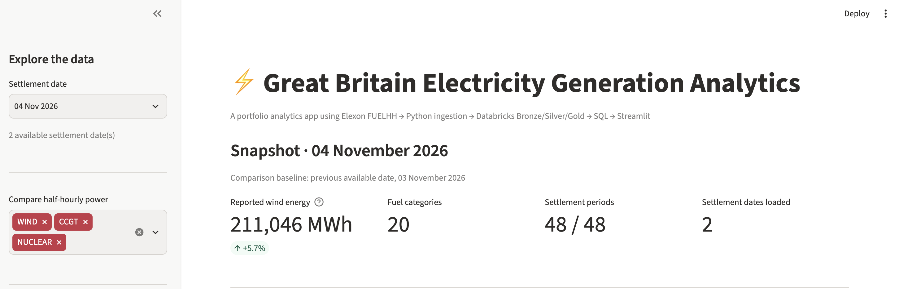
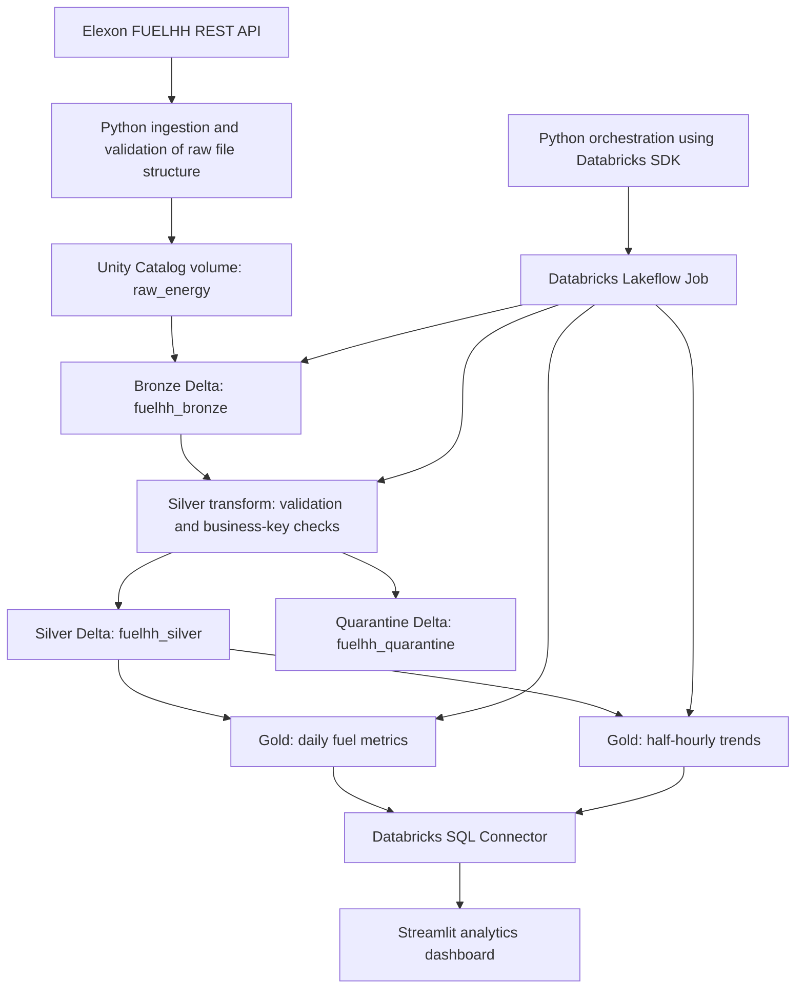
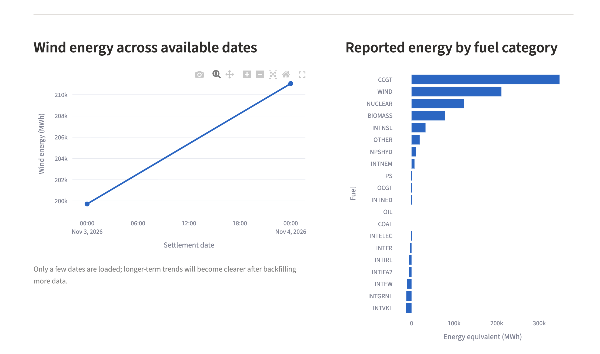
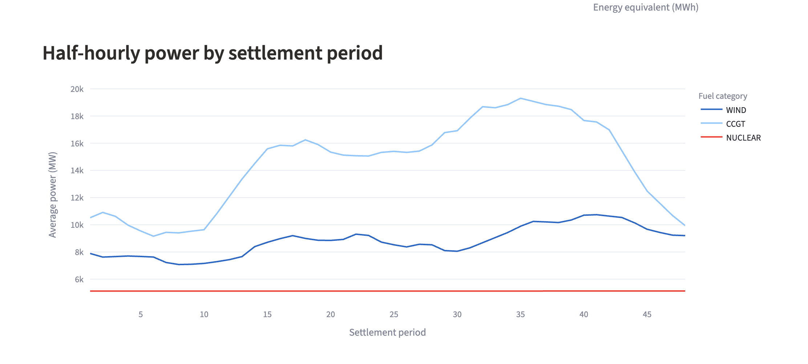
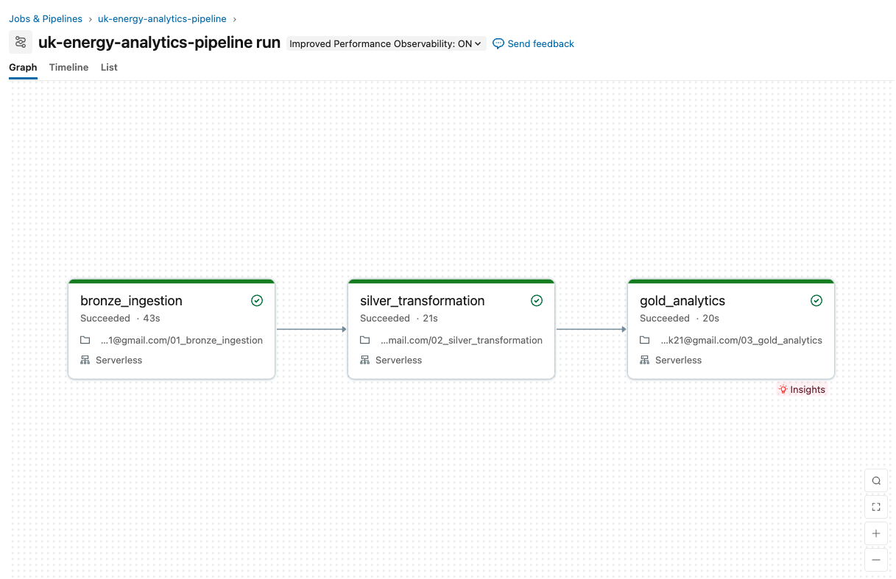
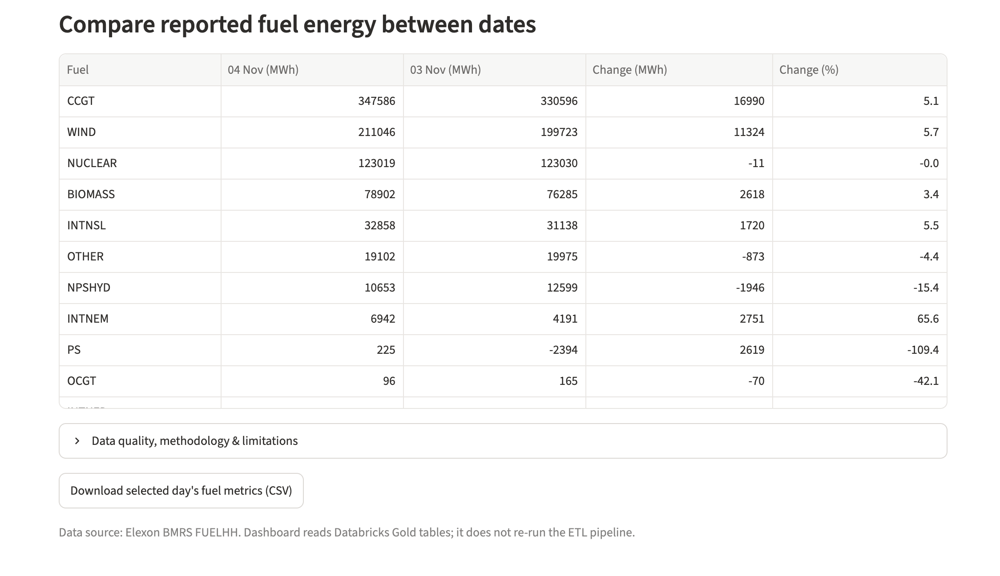

# Great Britain Electricity Generation Analytics Platform

**A Python-to-Databricks data engineering portfolio project using real Great Britain electricity-generation data from Elexon BMRS.**

The platform extracts half-hourly generation-by-fuel data, uploads raw JSON to a Unity Catalog volume, processes it through Bronze/Silver/Gold Delta tables, and serves business-facing reports through a Streamlit dashboard.

> **Scope:** This is an engineering demonstration, not a live operational electricity or trading system. The FUELHH dataset is not a complete measure of UK electricity generation, renewable share, or individual asset performance.


## Dashboard Preview

An interactive Streamlit dashboard powered by Databricks
Gold Delta tables, displaying electricity generation
metrics, fuel-category comparisons and daily trends.




## Architecture



The local application calls the Elexon API and uploads date-partitioned JSON files. An existing Databricks Job runs **Bronze → Silver → Gold** in dependency order. The Python SDK can start that Job and wait for completion with the `--run-job` flag. The dashboard queries the Gold tables; it does not perform the underlying Spark transformations.

## Technology stack

| Layer | Technology |
| --- | --- |
| Source ingestion | Python, `requests`, Elexon BMRS REST API |
| Raw file storage | Databricks Unity Catalog Volume |
| Transformations | PySpark, Spark SQL |
| Structured storage | Delta Lake, Unity Catalog |
| Orchestration | Databricks Lakeflow Jobs, Databricks Python SDK |
| Reporting | Databricks SQL Connector, Pandas, Plotly, Streamlit |
| Tests | Pytest |

## Data models

| Table | Grain / purpose |
| --- | --- |
| `fuelhh_bronze` | Raw FUELHH records, with ingestion timestamp and file provenance |
| `fuelhh_silver` | Typed, validated rows; candidate business key: `settlement_date`, `settlement_period`, `fuel_type` |
| `fuelhh_quarantine` | Records rejected due to quality failures or repeated candidate keys |
| `fuelhh_gold_daily_fuel` | One row per settlement date × fuel category, with period count, mean/peak MW and sum of half-hourly MWh equivalents |
| `fuelhh_gold_period_trends` | One row per settlement date × settlement period, with WIND, CCGT and NUCLEAR average MW values |

### Metrics and cautions

- FUELHH measures **average MW** across each 30-minute settlement period. To calculate an energy equivalent, **MWh = average MW × 0.5 hours**.
- Period counts are normally **48**, but GB daylight-saving clock changes can result in **46 or 50** settlement periods.
- Interconnector categories are **imports**, not domestic generation. Pumped storage is also included in the source categories.
- Embedded generation is not fully represented. Do **not** label the sum of all categories as total UK generation, or calculate a national renewable share from this dataset alone.
- The highest half-hourly average MW is not an instantaneous power peak.

## Project layout

```text
renewable-energy-analytics/
├── app.py                          # Streamlit reporting UI
├── databricks/
│   ├── 01_bronze_ingestion.py
│   ├── 02_silver_transformation.py
│   └── 03_gold_analytics.py
├── src/energy_pipeline/
│   ├── client.py                   # Elexon API client
│   ├── ingest.py                   # Local extraction orchestration
│   ├── bronze.py                   # Local raw file writer
│   ├── silver.py                   # Local reference transformations
│   ├── validation.py               # Record validation
│   ├── pipeline.py                 # Local date-range CLI
│   ├── databricks_ingest.py        # Volume upload and Job trigger
│   └── databricks_reader.py        # Gold table SQL access
├── tests/
├── requirements.txt
├── requirements-dev.txt
├── .env.example
└── README.md
```

The `databricks/` files are exported **Databricks notebook source files**. They run in Databricks, where a Spark session is provided; they are not intended to be launched as standalone local Python scripts.

## Quick start

### 1. Python setup (macOS / Linux)

```bash
python3.12 -m venv .venv
source .venv/bin/activate
python -m pip install -r requirements-dev.txt
cp .env.example .env
```

Set these `.env` variables for *your own* Databricks workspace: `DATABRICKS_SERVER_HOSTNAME`, `DATABRICKS_HTTP_PATH`, `DATABRICKS_CATALOG`, `DATABRICKS_SCHEMA`, `DATABRICKS_JOB_ID`. Never commit your real `.env` or credentials. The local SQL connector and SDK use browser-based OAuth authentication in this prototype.

### 2. Databricks setup

Create a Unity Catalog Volume named `raw_energy`, import the three notebooks under `databricks/`, and configure a Databricks Job with these task dependencies:

```text
01_bronze_ingestion → 02_silver_transformation → 03_gold_analytics
```

Ensure the notebooks' catalog and schema match your destination and that your Databricks SQL warehouse can query the Gold tables. Exported notebook source is version-controlled, but the Job definition is currently configured in the workspace UI rather than deployed automatically from this repository.

### 3. Run tests

```bash
PYTHONPATH=src python -m pytest -v
```

### 4. Ingest and execute the workflow

```bash
PYTHONPATH=src python -m energy_pipeline.databricks_ingest \
  --start 2026-11-03 --end 2026-11-04 --run-job
```

This command fetches raw Elexon data, uploads each day's JSON to the Unity Catalog Volume, triggers the existing Databricks Job, and waits for completion. Set up your Databricks workspace and authentication before running it. The command **rebuilds tables from the currently uploaded date-specific files**, not only from the date range supplied in this invocation.

### 5. Start the reporting application

```bash
PYTHONPATH=src python -m streamlit run app.py
```

Open `http://localhost:8501` and select a settlement date. The dashboard offers wind energy metrics, fuel mix by reported category, half-hourly WIND/CCGT/NUCLEAR comparisons, change against the previous available date, and a CSV export.

## Data quality and validation

The local Python pipeline includes schema/date/value validation, candidate-key duplicate detection, and quarantining. The Databricks Silver notebook implements equivalent core checks with native Spark expressions and sends rejected records to a quarantine table. There are **11 previously verified local pytest cases**; notebook/Delta integration checks are separate and should not be represented as covered by the local test count.

The pipeline tracks record counts at each layer and supports checking that Gold aggregations account for Silver records. Future work includes source-to-target parity tests, automated completeness assertions, and more comprehensive Databricks integration tests.

## Operational limitations and next steps

- **Full refresh, not incremental:** raw files for the same settlement date are overwritten, and the Databricks tables are rebuilt from available raw files.
- **Revisions:** historical source publication snapshots are not preserved immutably; `publishTime` is not yet used to resolve authoritative revisions.
- **Orchestration:** the Python command starts a remote Databricks Job, but the ingestion itself currently runs on the developer's machine rather than on scheduled cloud compute.
- **Deployment:** notebooks and job settings are not yet deployed through CI/CD or Databricks Asset Bundles.
- **Tests and observability:** more data-completeness assertions, alerting, and end-to-end tests are required for production use.
- **Dashboard:** small Gold results are currently fetched into Pandas; SQL-side filtering/pagination is preferable for much larger reporting datasets.


## Screenshots

### Energy Breakdown

Comparison of reported wind energy across settlement dates
and energy contributions by fuel category.



### Half-Hourly Generation Trends

Comparison of WIND, CCGT and NUCLEAR average power
across 48 settlement periods.



### Databricks ETL Workflow

Successful execution of the Bronze, Silver and Gold
transformations through a Databricks Lakeflow Job.



### Daily Fuel Comparison




## Data source

- [Elexon BMRS — Generation by fuel type](https://bmrs.elexon.co.uk/generation-by-fuel-type)
- [Elexon Insights API developer portal](https://developer.data.elexon.co.uk/)

This is an independent portfolio project and is not affiliated with or endorsed by Elexon, Databricks or Octopus Energy.
